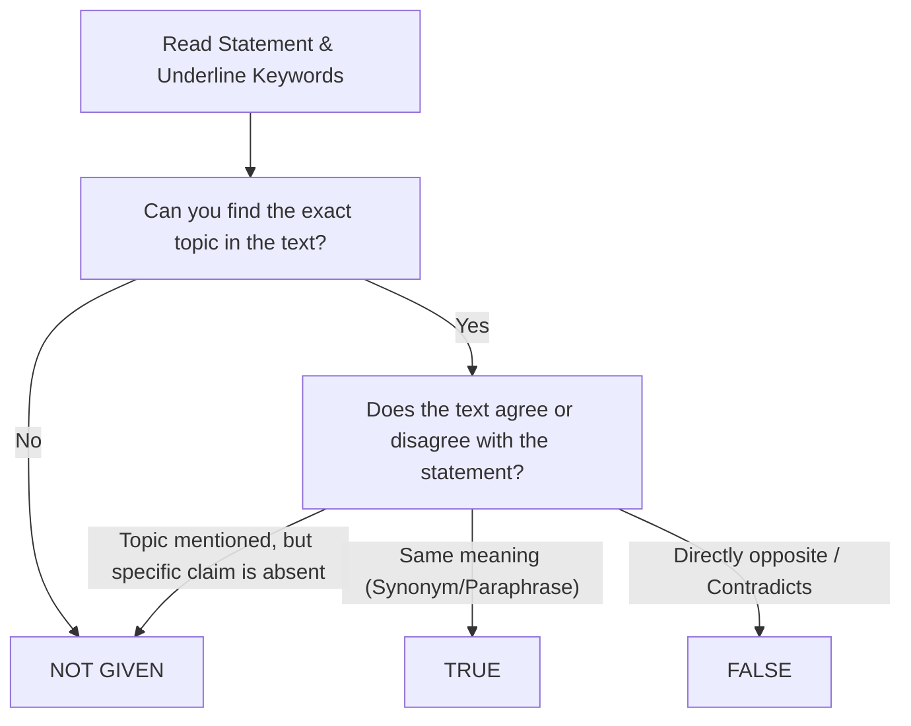

# IELTS General Training Reading Strategies: Reaching Band 7.0+ (34+/40)

To achieve **Band 7.0** in IELTS General Training Reading, you must score at least **34 to 35 out of 40**. In General Training, achieving 30/40 yields only a Band 6.0! This leaves you an error margin of only **5 to 6 questions**. 

---

## 1. Exam Structure & Strict Time Budget

The GT Reading test consists of 3 sections (40 questions, 60 minutes):

| Section | Content | Difficulty | Recommended Time | Target Accuracy |
|---|---|:---:|:---:|:---:|
| **Section 1** | 2–3 short texts (adverts, flyers, timetables, services) | Low | **14–15 minutes** | 13–14 / 14 |
| **Section 2** | 2 workplace texts (contracts, training manuals, safety rules) | Moderate | **18–20 minutes** | 12–13 / 13 |
| **Section 3** | 1 extended general-interest passage (magazine/journal style) | High | **25 minutes** | 10–12 / 13 |

> **Examiner Rule:** There is **no separate transfer time** for reading. You must write your answers directly onto the answer sheet during the 60 minutes.

---

## 2. True / False / Not Given: The Definitive Triad Rule

This question type causes the largest score loss for Band 6 candidates.

### The 3 Golden Rules:
1. **TRUE:** The passage directly confirms the statement. (Uses paraphrases and synonyms).
2. **FALSE:** The passage states the **direct opposite** or makes the statement impossible. If you can rewrite the text to directly contradict the statement, it is FALSE.
3. **NOT GIVEN:** The text does not give enough information to confirm or deny. Even if you know the statement is true in real life, if the text does not state it, it is **NOT GIVEN**.

### The Qualifying Words Trap
Watch out for extreme vs. moderate qualifiers:
- Absolute: *all, every, always, only, never, impossible*
- Moderate: *some, many, often, usually, possible, might*

> **Example:**  
> **Text:** *"Many local businesses experienced reduced revenue during the winter."*  
> **Question:** *"All local companies lost money in the winter months."*  
> **Answer:** **FALSE** (Because "many" does not mean "all"; the text contradicts the totality).

---

## 3. Matching Headings Without Getting Trapped

Headings questions test your ability to identify the **main idea** of a paragraph, not specific details.

### Why Candidates Fail:
- They see a keyword from Heading III inside Paragraph B and immediately choose Heading III. This is almost always a **distractor**.
- They read the entire paragraph word-for-word three times and run out of time.

### The 4-Step Method:
1. **Analyze Headings First:** Read all headings, underline the core noun/concept, and note differences between similar headings.
2. **Read the Opening & Closing:** Read the first two sentences of the paragraph carefully. Topic sentences are usually placed here. Then glance at the final sentence (which often summarizes or transitions).
3. **Summarize in 3 Words:** Before looking at the list of headings, ask yourself: *"What is this paragraph primarily about?"*
4. **Eliminate Used Headings:** Once a heading is verified, strike it off. If torn between two, mark both and return after reading surrounding paragraphs.

---

## 4. Skimming vs. Scanning vs. Intensive Reading

- **Skimming (30 seconds per passage):** Reading only titles, subheadings, and first sentences to create a mental map of where topics are located.
- **Scanning (10 seconds per question):** Moving your eyes rapidly across the text hunting for specific anchor terms (dates, capital letters, technical terms, numbers).
- **Intensive Reading (When you find the zone):** Slowing down to read 2–3 sentences with 100% comprehension once the scanned keyword is located.

