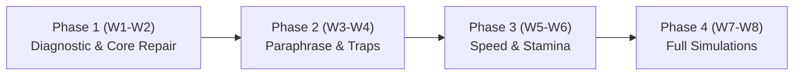

# Master Preparation Roadmap: 8-Week Path to CLB 9/10
### Targets: Listening 8.0 | Reading 7.0 | Writing 7.0 | Speaking 7.0

---

## 1. Study Time Allocation Matrix (Calibrated for Writing & Reading Priority)

| Module | Weekly Allocation | Weekly Hours (Regular: 7–8 hrs) | Priority Focus & Objective |
|---|:---:|:---:|---|
| **Writing** | **40%** | 3.0 – 3.5 Hours | **Primary Focus.** Task 1 letter conventions, Task 2 Band 7 PEEL paragraphs, grammatical accuracy, avoiding Band 6.5 plateau. |
| **Reading (GT)** | **35%** | 2.5 – 3.0 Hours | **Primary Focus.** Closing the 30 to 34+ gap. Speed scanning, TFNG contradiction logic, Section 3 academic/general text handling. |
| **Listening** | **15%** | 1.0 – 1.5 Hours | High-efficiency Section 4 maintenance, distractor immunity, maintaining Band 8.0 baseline. |
| **Speaking** | **10%** | 0.75 – 1.0 Hour | Part 2 two-minute cue card frameworks, Part 3 PREP formula, natural discourse markers. |

---

## 2. Four-Phase Curriculum Breakdown

### Phase 1: Diagnostic & Core Skill Repair (Weeks 1 – 2)
*Goal: Fix recurring mechanical errors and establish examiner-standard formats.*
- **Listening:** Section 1 & 2 100% accuracy drill; Section 4 prediction techniques; spelling and number transcription drills.
- **Reading:** General Training Section 1 (notices/advertisements) and Section 2 (workplace contracts, safety guidelines). Demystifying the True/False/Not Given decision rule.
- **Writing:** Task 1 Tone mastery (Formal vs. Semi-Formal vs. Informal); Task 2 Essay anatomy (Introductory thesis, 2 body paragraphs, definitive conclusion).
- **Speaking:** Part 1 natural extension (adding "why" and "for example" without pauses); Part 2 1-minute cue card note-taking system.
- **Assessment:** Day 1 Comprehensive Diagnostic + Day 7 Weekly Review Mini-Mock.

### Phase 2: Paraphrase Decryption & Distractor Immunity (Weeks 3 – 4)
*Goal: Eliminate Band 6 traps in Listening and Reading; elevate vocabulary precision in Writing/Speaking.*
- **Listening:** Section 3 multi-speaker academic conversations; recognizing speaker self-correction (*"I thought X, but actually Y"*); synonym mapping before audio plays.
- **Reading:** Section 3 long general-interest text (Cambridge standard); Matching Headings without reading every line; Matching Information to paragraphs.
- **Writing:** Task 2 Coherence & Cohesion (discourse markers, pronouns, referencing); Lexical Resource (avoiding "thesaurus syndrome"; using natural collocations).
- **Speaking:** Part 3 Abstract Reasoning using the **PREP Formula** (Point, Reason, Example, Perspective); eliminating filler sounds ("umm", "uhh").
- **Assessment:** Week 3 Mid-Phase Review + Week 4 Comprehensive Assessment 1.

### Phase 3: High-Speed Stamina & Error Pruning (Weeks 5 – 6)
*Goal: Build the mental endurance to maintain focus through Section 4 and finish GT Reading in 50 minutes.*
- **Listening:** Section 4 intense non-stop academic monologues; handling rapid-fire questions (3 questions in 15 seconds); accent variety (British, Australian, North American).
- **Reading:** 55-minute strict GT Reading drills; rapid elimination of incorrect multiple-choice options; Yes/No/Not Given (claims of author vs. factual statements).
- **Writing:** Full 60-minute combined Task 1 (20 mins) + Task 2 (40 mins) under exam pressure; strict word count control; self-editing checklist.
- **Speaking:** Full 14-minute simulated speaking interviews with unpredictable follow-up questions.
- **Assessment:** Week 5 Target Sprint + Week 6 Full Simulation Mock 1.

### Phase 4: Full-Length Simulations & Exam Precision (Weeks 7 – 8)
*Goal: Zero careless mistakes, peak test-day confidence, and automated exam execution.*
- **Listening:** 3 full Cambridge Listening tests under strict headphones-only, single-play conditions.
- **Reading:** 3 full GT Reading tests with a target of 36+/40.
- **Writing:** Polishing high-scoring grammatical structures (conditionals, passive voice, inversion, non-defining relative clauses).
- **Speaking:** Fluency conditioning; natural recovery techniques when making an error.
- **Assessment:** Full Simulation Mock 2 (Day 49) & Final Readiness Clearance (Day 56).

---

## 3. Weekly Schedule Blueprint

| Day | Regular Day Routine (60–90 Mins) | Busy Day Routine (30 Mins MED) |
|---|---|---|
| **Monday** | Listening Section Focus (30m) + Reading Passage (30m) + Vocab (15m) | Listening Drill (20m) + Vocab Review (10m) |
| **Tuesday** | Listening Paraphrase Drill (25m) + Writing Task 1 (35m) + Vocab (15m) | Writing Planning Drill (20m) + Vocab (10m) |
| **Wednesday**| Reading Section 2/3 (35m) + Speaking Part 1/2 (25m) + Vocab (15m) | Reading Scanning Drill (20m) + Vocab (10m) |
| **Thursday**| Listening Section 4 Focus (35m) + Writing Task 2 Outline/Body (35m) | Listening Section 4 Drill (20m) + Strategy (10m) |
| **Friday** | Reading TFNG/Headings (35m) + Speaking Part 3 (25m) + Vocab (15m) | Speaking Audio Drill (20m) + Vocab (10m) |
| **Saturday**| **Weekly Deep-Dive Session (2–2.5 Hours):** Timed Mini-Mock / Full Test + Line-by-Line Error Log Audit | Deep-Dive Session shifted to morning or Sunday |
| **Sunday** | **Rest & Recovery Day:** Light 15-min flashcard/vocabulary revision | Complete Rest |

